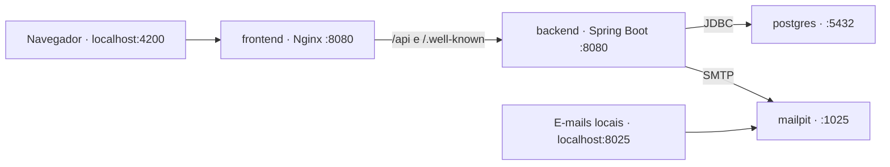

# Achernar Identity

Microserviço de identidade para **gerenciar usuários e perfis de acesso**, acompanhado de uma aplicação web administrativa. Oferece cadastro, confirmação de e-mail, autenticação com JWT, recuperação de senha e associação de múltiplos perfis por usuário.

## Subir com Docker

### Pré-requisitos

- Docker instalado e em execução, com Docker Compose v2 (`docker compose`).
- Portas locais `4200`, `8080`, `5432`, `8025` e `1025` disponíveis.
- Execute os comandos na **raiz do projeto**, onde estão `backend/`, `frontend/` e `docker/`. Se estiver dentro do motor `achernar_ia/`, volte um nível com `cd ..`.

O Docker compila o backend e o frontend dentro das imagens. Java, Maven e Node.js na máquina são necessários somente para desenvolvimento fora dos containers.

### 1. Configurar o ambiente

Na primeira execução, copie o exemplo:

```bash
cp docker/.env.example docker/.env
```

**Se `docker/.env` já existe, preserve esse arquivo e suas credenciais.** O ambiente local já configurado pode seguir diretamente para o passo 2.

Para uma instalação nova, com banco vazio, edite `docker/.env`. Exemplo de configuração exclusivamente para testes locais:

```dotenv
DATABASE_PASSWORD=IdentityLocalDatabase2026!
ADMIN_EMAIL=admin@achernar.local
ADMIN_PASSWORD=KkGMZOCCV_dZ0Hzuh3OnBc63wjEbTS5O
JWT_ADDITIONAL_AUDIENCES=
JWT_ISSUER=http://localhost:8080
```

`DATABASE_PASSWORD` é a senha do banco; `ADMIN_PASSWORD` é a senha de acesso à aplicação. A senha administrativa deve ter entre 12 e 128 caracteres. O arquivo `.env` é ignorado pelo Git.

### 2. Construir e iniciar

```bash
docker compose --env-file docker/.env -f docker/docker-compose.yml up --build -d
```

O Compose inicia PostgreSQL, Mailpit, backend e frontend. As migrações Liquibase são aplicadas automaticamente pelo backend. Aguarde a inicialização antes de acessar a aplicação.

### 3. Acessar

| Serviço | Endereço | Uso |
|---|---|---|
| Aplicação web | [localhost:4200](http://localhost:4200) | Cadastro, login, conta, usuários e perfis |
| API | [localhost:8080/api/health](http://localhost:8080/api/health) | Verificação de disponibilidade do backend |
| E-mails de teste | [localhost:8025](http://localhost:8025) | Ler confirmações, convites e recuperação de senha no Mailpit |
| Chaves públicas JWT | [JWKS](http://localhost:8080/.well-known/jwks.json) | Validar assinatura nos serviços consumidores |
| PostgreSQL | `localhost:5432` | Banco `identity`, usuário `identity`; senha definida em `DATABASE_PASSWORD` |

### Administrador de teste

As credenciais abaixo estão configuradas no ambiente local desta entrega e podem ser usadas no exemplo de instalação nova acima:

| Campo | Valor |
|---|---|
| E-mail | `admin@achernar.local` |
| Senha | `KkGMZOCCV_dZ0Hzuh3OnBc63wjEbTS5O` |
| Perfil | `ADMIN` |

**Estas credenciais são públicas de teste; use outras credenciais em ambiente publicado.**

O administrador é criado no primeiro início pelo bootstrap, a partir de `ADMIN_EMAIL` e `ADMIN_PASSWORD`, com e-mail confirmado. Se o endereço já existe, o bootstrap preserva a conta, sua senha e seus perfis. Alterar `ADMIN_PASSWORD` no `.env` não redefine a senha de uma conta existente; utilize a recuperação de senha para isso.

Após entrar, use **Usuários** para administrar as contas e **Perfis** para manter o catálogo de acessos. O administrador também pode criar um usuário por convite: o destinatário recebe um link para confirmar o e-mail e definir sua própria senha.

### Comandos úteis

Consultar os containers:

```bash
docker compose --env-file docker/.env -f docker/docker-compose.yml ps
```

Acompanhar os logs do backend:

```bash
docker compose --env-file docker/.env -f docker/docker-compose.yml logs -f backend
```

Atualizar a aplicação após alterações no código:

```bash
docker compose --env-file docker/.env -f docker/docker-compose.yml up --build -d
```

Parar e remover os containers, preservando os volumes:

```bash
docker compose --env-file docker/.env -f docker/docker-compose.yml down
```

Os volumes `postgres_data` e `signing_keys` preservam, respectivamente, os dados do banco e a chave de assinatura JWT. Reiniciar ou reconstruir as imagens não apaga as contas. Adicionar `-v` ao comando `down` remove esses volumes e apaga o banco e a chave; reserve essa opção para reiniciar deliberadamente um ambiente descartável.

A senha do PostgreSQL é definida ao inicializar o volume. Se ele já contém dados, mudar apenas `DATABASE_PASSWORD` no `.env` não altera a senha armazenada no banco.

## Funcionalidades

- Cadastro público com nome, e-mail e senha, recebendo somente o perfil `USER`.
- Confirmação e reenvio de e-mail, obrigatórios antes do primeiro login.
- Login por e-mail e senha, restauração da sessão e saída de todas as sessões.
- Recuperação e redefinição de senha por e-mail.
- Consulta da própria conta e alteração do nome.
- Inclusão administrativa por convite, listagem paginada, busca, detalhe e edição de usuários.
- Bloqueio, desbloqueio e exclusão lógica, com anonimização dos dados da conta.
- CRUD de perfis com busca, paginação, ativação e desativação.
- Associação de múltiplos perfis ativos a cada usuário.
- Proteção dos perfis de sistema `ADMIN` e `USER`, do próprio acesso administrativo e do último administrador ativo e confirmado.
- Auditoria de operações sensíveis e envio de e-mails por fila persistida.
- Emissão de JWT com perfis, publicação de JWKS e consulta de sessão para consumidores.

Perfil vinculado a usuários não pode ser excluído. Desativar um perfil revoga as sessões das contas vinculadas. Alterar administrativamente o e-mail de uma conta exige nova confirmação. A autenticação com Google está prevista para uma evolução futura.

## Stack

| Área | Tecnologias |
|---|---|
| Backend | Java 25, Spring Boot 4.1, Spring Web MVC e Maven |
| Segurança | Spring Security, JWT RS256, JWKS, Argon2 e proteção CSRF |
| Persistência | Spring JDBC, SQL explícito e PostgreSQL 18 |
| Migrações | Liquibase |
| E-mail | Spring Mail, SMTP e outbox transacional; Mailpit no ambiente local |
| Frontend | Angular 22, TypeScript 6, componentes standalone e Signals |
| Interface | Angular Material, CDK, SCSS e ícones SVG locais |
| Estado e comunicação | Feature services, RxJS e HttpClient |
| Internacionalização | Transloco, com português do Brasil configurado |
| Execução | Docker Compose, Dockerfiles multi-stage e Nginx |
| Testes | JUnit Jupiter, Mockito, Spring Security Test, Vitest e Playwright |

## Organização do repositório

```text
achernar_identity/
├── backend/                 # Microserviço de identidade e API
│   ├── src/main/java/       # Slices, domínio e infraestrutura
│   ├── src/main/resources/ # Configuração e migrações
│   ├── src/test/java/       # Testes unitários e integrados
│   ├── docs/                # Integração JWT com outros serviços
│   ├── pom.xml
│   └── Dockerfile
├── frontend/                # Aplicação Angular
│   ├── src/app/             # Features, sessão e navegação
│   ├── src/assets/          # Logo e ícones
│   ├── public/i18n/         # Traduções
│   ├── e2e/                 # Testes de navegador
│   ├── nginx.conf
│   ├── package.json
│   └── Dockerfile
├── docker/
│   ├── docker-compose.yml   # Serviços, rede, portas e volumes locais
│   └── .env.example         # Modelo de variáveis de ambiente
├── requisitos/              # HUs, contratos, decisões e evidências
└── achernar_ia/             # Motor de orientação e workflow do projeto
```

### Backend: Vertical Slice Architecture

O backend é organizado por **capacidade funcional**, com separação interna das responsabilidades de entrada, aplicação e persistência. Cada slice reúne seus controllers, serviços e contratos, em vez de existir uma única pasta global de controllers ou services para o sistema inteiro.

```text
com.achernar.identity/
├── auth/        # Cadastro, login, e-mail, convites e recuperação
├── account/     # Consulta e alteração da conta autenticada
├── admin/       # Administração de usuários
├── profiles/    # Catálogo e CRUD de perfis
├── users/       # Agregado de usuário, consultas e acesso compartilhado
├── security/    # Cadeia de segurança, assinatura/validação JWT e limites
├── mail/        # Outbox e entrega SMTP
├── bootstrap/   # Provisionamento inicial do administrador
└── shared/      # Auditoria e tratamento de erros compartilhados
```

O fluxo dentro de uma funcionalidade segue:

```text
Requisição HTTP → Controller → Service → Repository → PostgreSQL
```

- Controllers validam a entrada e delegam aos serviços.
- Serviços coordenam regras de negócio e limites transacionais.
- Repositories declaram o SQL explicitamente, com parâmetros vinculados, projeções, filtros, paginação e ordenação estável.
- Leituras independentes, que dispensam consistência transacional, usam `Propagation.NOT_SUPPORTED`; escritas e operações com locks usam transações de serviço.
- A persistência usa JDBC. As associações entre usuários e perfis são mantidas por identificadores, sem mapeamentos bidirecionais de objetos.
- DTOs controlam o que entra e sai da API; senhas e hashes não são retornados.
- O código não utiliza Lombok. O Liquibase versiona as alterações de schema, preservando as migrações já aplicadas.

`users/`, `security/`, `mail/` e `shared/` concentram responsabilidades realmente compartilhadas. A solução mantém um único microserviço de identidade, com seu próprio banco; os demais microserviços de negócio podem consumir as credenciais emitidas por ele.

### Frontend: organização por features

O frontend é uma SPA Angular com carregamento lazy das funcionalidades:

```text
src/app/
├── app.component.*          # Shell, marca e navegação
├── app.routes.ts            # Rotas raiz e carregamento lazy
├── core/
│   ├── auth/                # Sessão, guards, interceptor e CSRF
│   └── models/              # Tipos transversais, como paginação
└── features/
    ├── auth/                # Login, cadastro, confirmação e recuperação
    ├── account/             # Conta do usuário autenticado
    ├── admin/               # Administração de usuários
    └── profiles/            # Administração de perfis
```

Dentro de cada feature, conforme a necessidade:

| Pasta | Responsabilidade |
|---|---|
| `pages/` | Componentes smart: coordenam estado, serviços e navegação |
| `components/` | Componentes de apresentação: recebem dados e emitem eventos |
| `services/` | Chamadas HTTP e operações da funcionalidade |
| `models/` | Contratos e modelos de domínio da feature |

Os componentes são standalone, usam Signals para estado e mantêm **`.html`, `.scss` e `.ts` separados**. A identidade visual deriva da logo Achernar Identity, com temas claro/escuro e ícones SVG locais. Os guards ajudam a navegação; a autorização das operações é aplicada novamente no backend.

### Docker e comunicação entre serviços



- **`backend/Dockerfile`:** compila com Maven/Java 25 e executa o JAR em uma imagem JRE, com usuário sem privilégios de root.
- **`frontend/Dockerfile`:** instala dependências com `npm ci`, gera o build de produção e serve os arquivos com Nginx sem privilégios de root.
- **`frontend/nginx.conf`:** entrega a SPA e encaminha `/api` e `/.well-known` ao backend pela rede interna do Compose.
- **`docker/docker-compose.yml`:** conecta os quatro serviços, configura as variáveis, expõe as portas somente em `127.0.0.1` e mantém os volumes persistentes.
- **Mailpit:** recebe os e-mails da aplicação no ambiente local; não é necessário configurar um provedor real para testar confirmação, convite e recuperação.

## JWT e integração com outros microserviços

O token é assinado com RS256 e carrega, entre outros dados, `sub`, `iss`, `aud`, `exp`, `jti`, a versão de sessão e os códigos dos perfis ativos em **`roles`**. O navegador usa cookie HttpOnly; clientes que precisam de Bearer podem obter a credencial pelo contrato de emissão da API.

A sessão dura 15 minutos. Saída, redefinição de senha, bloqueio e mudanças de acesso invalidam as versões anteriores no serviço de identidade. Links de confirmação e convite duram 24 horas; recuperação de senha dura 30 minutos. As provas de ação são de uso único.

Cada consumidor valida assinatura, emissor, destinatário e expiração e aplica suas próprias regras por perfil. **Validação somente local pode aceitar um token revogado até ele expirar.** Para revogação imediata, o consumidor também consulta a sessão no serviço de identidade.

Configure os destinatários adicionais em `JWT_ADDITIONAL_AUDIENCES`, separados por vírgula. O guia completo, com exemplos Spring Security e consulta de sessão, está em [Consumir o JWT](backend/docs/consumir-jwt.md).

## Desenvolvimento fora do Docker

Use Java 25, Maven compatível com o projeto e Node.js 24. Para iniciar somente as dependências locais:

```bash
docker compose --env-file docker/.env -f docker/docker-compose.yml up -d postgres mailpit
```

Para executar FE e BE no host, pare seus containers se já estiverem usando as portas:

```bash
docker compose --env-file docker/.env -f docker/docker-compose.yml stop backend frontend
```

No terminal do backend, configure `DATABASE_PASSWORD` com o valor real do seu `.env`, além de `COOKIE_SECURE=false` e `JWT_GENERATE_KEY=true`. Para criar o administrador em um banco novo, configure também `ADMIN_EMAIL` e `ADMIN_PASSWORD`. Em seguida:

```bash
cd backend
mvn spring-boot:run
```

Em outro terminal, a partir da raiz:

```bash
cd frontend
npm ci
npm start
```

O servidor Angular utiliza o proxy local para encaminhar `/api` ao backend na porta 8080. A configuração do backend está em [application.yaml](backend/src/main/resources/application.yaml); o Compose fornece as variáveis automaticamente quando a execução é feita em containers.

## Validação

No diretório `backend/`:

```bash
mvn test
```

Os testes integrados precisam de um banco separado, chamado `identity_test`. **Eles apagam os dados desse banco**; não utilize o banco da aplicação. Depois de criá-lo, configure `DATABASE_PASSWORD` e execute:

```bash
TEST_DATABASE_URL=jdbc:postgresql://localhost:5432/identity_test mvn verify -Pintegration
```

No diretório `frontend/`:

```bash
npm test
npm run lint
npm run build -- --configuration production
```

Com aplicação e Mailpit em execução, `docker/.env` configurado e credenciais administrativas válidas, os testes de navegador podem ser executados com:

```bash
npx playwright install chromium
npm run e2e
```

Os testes de navegador criam contas e perfis temporários e os removem ao concluir; execute-os em ambiente de testes. O build das imagens Docker usa testes separados: construir a imagem não substitui os comandos de validação acima.

## Documentação funcional

O módulo está dividido em **dez histórias de usuário**, com contratos compartilhados de negócio, API, dados, interface, segurança e testes:

- [Mapa das HUs](requisitos/specs/UC-001-identidade/historias.md).
- [Contrato da API](requisitos/specs/UC-001-identidade/api.md).
- [Decisões de implementação](requisitos/specs/UC-001-identidade/implementation-decisions.md).
- [Relatórios de validação](requisitos/reviews/).

## Ambiente publicado

O Compose entregue é voltado ao desenvolvimento e aos testes locais. Para publicar, configure SMTP real com autenticação/TLS, HTTPS, credenciais próprias, `COOKIE_SECURE=true`, `ACTION_URL` e `JWT_ISSUER` públicos e uma chave RSA previamente provisionada com `JWT_GENERATE_KEY=false`. Esses ajustes devem ser feitos na configuração de implantação; o Compose local fixa algumas opções para HTTP e Mailpit.

Planeje backup do banco e das chaves, retenção de auditoria e monitoramento da outbox. A fila repete entregas com intervalo crescente; uma falha entre envio SMTP e confirmação pode repetir a mensagem, mas seu link só pode ser consumido uma vez. A limitação atual de tentativas é por processo/origem; ao executar várias réplicas, configure um limite compartilhado no gateway.
