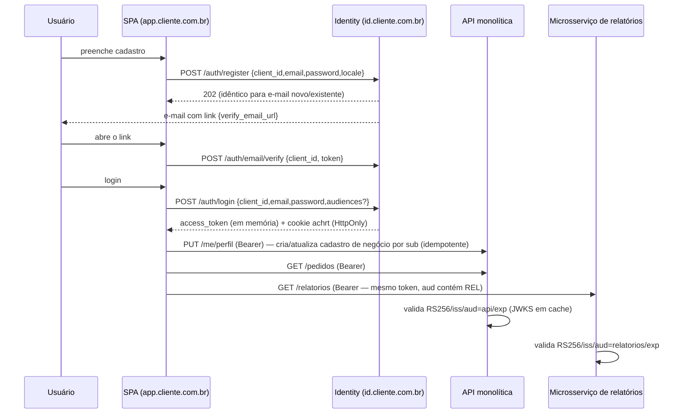

# Achernar Identity — Guia de Integração das Aplicações Consumidoras

Contratos: `api-conventions.md`, `token-lifecycle.md`, `FT-xx/api.md`. Este guia **descreve configuração e contratos**; não há projeto consumidor nesta fase (§5 do prompt).
Regras: RN-APP-*, RN-TOK-14, D-07…D-10, D-28. Controles: SEC-12…SEC-16, SEC-34.

## 1. Topologias suportadas

| Topologia | Cliente no Identity | Observações |
|---|---|---|
| SPA + API monolítica | SPA = `BROWSER`; API = `resource_api` | SPA no mesmo site do Identity (D-07). API valida JWT localmente. |
| SPA + monolito + microsserviço de relatórios | SPA = `BROWSER`; duas `resource_api` (`https://api…`, `https://relatorios…`) | O token traz as duas audiências; cada API só aceita se **a sua** está em `aud`. |
| SSR/BFF (Next, Node, Spring MVC) ou SPA em outro site | servidor = `CONFIDENTIAL` | O servidor guarda `refresh_token`, entrega cookie de sessão **próprio** ao navegador, repassa o access às APIs. |
| API com operações críticas | `resource_api` com credencial de introspecção | Introspecção para bloqueio imediato (D-10). |

Não há SSO entre aplicações independentes: cada aplicação tem **sessão própria** (cookie/refresh por `client_id`).

## 2. Registro (feito por um administrador na UI do Identity ou via API admin)

1. **APIs** (`/api/v1/admin/apis`): `audience` (ex.: `https://api.cliente.com.br`), nome. Para quem fará introspecção: gerar **credencial** (exibida uma vez).
2. **Aplicação** (`/api/v1/admin/applications`): `client_id`, nome, tipo, **origens** (`https://app.cliente.com.br`), **redirect_uris** (`https://app.cliente.com.br/auth/callback`),
   **URLs de ação** (`verify_email_url=https://app.cliente.com.br/verificar-email`, `reset_password_url=…/redefinir-senha`, `confirm_email_change_url=…/confirmar-email`),
   APIs permitidas e padrão, `allow_registration`, provedores sociais, TTL opcional. `CONFIDENTIAL`: guardar o `client_secret` exibido uma vez em cofre.
3. Configurar no provedor social a URL de retorno do **Identity** (não da aplicação).
4. Em cada API: configurar `issuer`, `jwk-set-uri` e `audience` (§4).
5. `client_id`, origens e redirect URIs são **identificadores públicos**; não provam autenticação da aplicação (RN-APP-05). Nunca colocar `client_secret` no frontend.

## 3. Fluxo ponta a ponta (SPA `BROWSER`)



## 4. Configuração mínima de uma API Spring Security 7 (Resource Server)

### 4.1 Somente propriedades (Spring Boot 4.1 / Spring Security 7)

```yaml
spring:
  security:
    oauth2:
      resourceserver:
        jwt:
          jwk-set-uri: https://id.cliente.com.br/.well-known/jwks.json   # chaves (sem descoberta no start)
          issuer-uri: https://id.cliente.com.br                          # com jwk-set-uri presente, só valida `iss`
          audiences: https://api.cliente.com.br                          # a audiência DESTA API
          jws-algorithms: RS256
```
Microsserviço de relatórios: mesma configuração, mudando só `audiences: https://relatorios.cliente.com.br`.

### 4.2 Configuração explícita (com verificação do `typ` e tolerância de relógio)

```java
@Configuration
@EnableMethodSecurity
class ResourceServerConfig {

  @Bean
  SecurityFilterChain api(HttpSecurity http) throws Exception {
    http
      .csrf(csrf -> csrf.disable())                                   // API Bearer sem cookies
      .sessionManagement(s -> s.sessionCreationPolicy(SessionCreationPolicy.STATELESS))
      .authorizeHttpRequests(a -> a
          .requestMatchers("/actuator/health/**").permitAll()
          .anyRequest().authenticated())
      .oauth2ResourceServer(o -> o.jwt(j -> j.jwtAuthenticationConverter(new BusinessAuthoritiesConverter())));
    return http.build();
  }

  @Bean
  JwtDecoder jwtDecoder(@Value("${app.identity.issuer}") String issuer,
                        @Value("${app.identity.jwks-uri}") String jwksUri,
                        @Value("${app.identity.audience}") String audience) {
    NimbusJwtDecoder decoder = NimbusJwtDecoder.withJwkSetUri(jwksUri)
        .jwsAlgorithm(SignatureAlgorithm.RS256)                       // somente RS256
        .jwtProcessorCustomizer(p -> p.setJWSTypeVerifier(
            new DefaultJOSEObjectTypeVerifier<>(new JOSEObjectType("at+jwt"))))
        .build();

    OAuth2TokenValidator<Jwt> issuerAndTime = JwtValidators.createDefaultWithIssuer(issuer); // iss, exp, nbf (skew 60 s)
    OAuth2TokenValidator<Jwt> audienceValidator = new JwtClaimValidator<List<String>>(
        JwtClaimNames.AUD, aud -> aud != null && aud.contains(audience));
    OAuth2TokenValidator<Jwt> hasSub = new JwtClaimValidator<String>(JwtClaimNames.SUB, s -> s != null && !s.isBlank());
    decoder.setJwtValidator(new DelegatingOAuth2TokenValidator<>(issuerAndTime, audienceValidator, hasSub));
    return decoder;
  }
}

/** Permissões de NEGÓCIO vêm do banco da API, indexadas por `sub` — nunca de claims do Identity. */
class BusinessAuthoritiesConverter implements Converter<Jwt, AbstractAuthenticationToken> {
  public AbstractAuthenticationToken convert(Jwt jwt) {
    var authorities = permissionRepository.findByAccountId(UUID.fromString(jwt.getSubject()))
        .stream().map(p -> new SimpleGrantedAuthority("PERM_" + p)).toList();
    return new JwtAuthenticationToken(jwt, authorities, jwt.getSubject());
  }
}
```
Uso: `@PreAuthorize("hasAuthority('PERM_PEDIDO_LER')")` e `@AuthenticationPrincipal Jwt jwt` ⇒ `jwt.getSubject()` é o vínculo com a tabela de negócio.

### 4.3 Checklist de validação da API (RN-TOK-14)

☑ assinatura RS256 com chaves do JWKS (cache respeitando `Cache-Control`; refetch ao ver `kid` desconhecido, com limite) ☑ `iss` idêntico ao configurado ☑ `aud` contém **a sua** audiência
☑ `exp`/`nbf` (skew ≤ 60 s) ☑ `sub` presente ☑ rejeitar `alg` ≠ RS256 ☑ não aceitar tokens por query string ☑ responder `401` com `WWW-Authenticate: Bearer` ☑ não registrar o token em logs
☑ tratar `sub` como identificador opaco ☑ **nunca** usar e-mail como chave.

### 4.4 Bloqueio imediato (operações sensíveis) — introspecção

```java
@Service
class IdentityIntrospection {
  private final RestClient http;           // baseUrl = issuer; Basic = audience:segredo da API
  @Cacheable(cacheNames = "introspection", key = "#sid")   // TTL ≤ 30 s (P-46), por sid
  public boolean isActive(String rawToken, String sid) {
    var r = http.post().uri("/api/v1/tokens/introspect")
        .contentType(MediaType.APPLICATION_FORM_URLENCODED).body("token=" + URLEncoder.encode(rawToken, UTF_8))
        .retrieve().body(Map.class);
    return Boolean.TRUE.equals(r.get("active"));
  }
}
// Em operações sensíveis: if (!introspection.isActive(token, jwt.getClaimAsString("sid"))) throw new AccessDeniedException("sessão encerrada");
// Falha de rede/5xx do Identity ⇒ negar a operação sensível (fail-closed).
```

### 4.5 Teste mínimo (sem Identity)

`MockMvc` + `SecurityMockMvcRequestPostProcessors.jwt().jwt(j -> j.subject(uuid).audience(List.of("https://api.cliente.com.br")))` valida autorização de negócio; um teste de integração contra o
Identity local (Docker) valida assinatura/`aud`/`exp` ponta a ponta (CT-INT-01…).

## 5. Contrato do frontend (qualquer framework; não precisa ser Angular)

```ts
// Módulo de autenticação — token SOMENTE em memória
let accessToken: string | null = null, expiresAt = 0;
const idp = 'https://id.cliente.com.br', clientId = 'meu-app-web';

async function login(email: string, password: string) {
  const r = await fetch(`${idp}/auth/login`, { method: 'POST', credentials: 'include',
    headers: { 'Content-Type': 'application/json' }, body: JSON.stringify({ client_id: clientId, email, password }) });
  if (!r.ok) throw await r.json();              // application/problem+json
  setTokens(await r.json());
}
function setTokens(t: any) { accessToken = t.access_token; expiresAt = Date.now() + t.expires_in * 1000; }

// Renovação single-flight entre abas
async function refresh(): Promise<boolean> {
  return navigator.locks.request(`achernar-refresh:${clientId}`, async () => {
    if (accessToken && expiresAt - Date.now() > 5000) return true;          // outra aba já renovou
    const r = await fetch(`${idp}/auth/refresh`, { method: 'POST', credentials: 'include',
      headers: { 'Content-Type': 'application/json', 'X-Achernar-Client': clientId },
      body: JSON.stringify({ client_id: clientId }) });
    if (!r.ok) { accessToken = null; return false; }                       // 401 ⇒ ir para login
    setTokens(await r.json()); return true;
  });
}
export async function api(path: string, init: RequestInit = {}) {
  if (!accessToken || expiresAt - Date.now() < 30000) await refresh();     // proativo
  let r = await fetch(path, { ...init, headers: { ...init.headers, Authorization: `Bearer ${accessToken}` } });
  if (r.status === 401 && await refresh())                                  // no máx. 1 retentativa
    r = await fetch(path, { ...init, headers: { ...init.headers, Authorization: `Bearer ${accessToken}` } });
  return r;
}
```
Regras: nunca persistir o access token; ao carregar a página chamar `refresh()` para reidratar; logout = `POST /auth/logout` + descartar token + `BroadcastChannel`.

## 6. Criação da conta no Identity × cadastro de negócio (sem transação distribuída)

**Padrão recomendado: provisionamento preguiçoso e idempotente por `sub` (D-28).**

1. O Identity cria **apenas** a identidade (e-mail/senha/verificação). Dados de negócio (CPF, endereço…) **não** passam pelo Identity.
2. Após o primeiro login, a aplicação envia o cadastro de negócio à **sua API**: `PUT /me/perfil` com o Bearer; a API faz **upsert** por `sub` (chave única no banco de negócio).
3. Qualquer chamada autenticada a uma API sem cadastro de negócio retorna `409/428 PROFILE_REQUIRED` (contrato da API de negócio) e o front direciona ao formulário “completar cadastro”.

| Falha parcial | Efeito | Tratamento |
|---|---|---|
| Timeout no `POST /auth/register` | desconhecido | repetir: cadastro é idempotente e a resposta é sempre 202 |
| Conta criada, e-mail não chegou | pendente | `POST /auth/email/resend-verification` (limites P-34) |
| Verificada, mas `PUT /me/perfil` falhou | identidade sem perfil de negócio | repetir o PUT (idempotente); a API não depende de ordem |
| `PUT /me/perfil` enviado duas vezes | duplicidade | `UNIQUE(account_id)` na tabela de negócio ⇒ segunda vira atualização |
| Perfil de negócio para conta depois desativada/anonimizada | dados órfãos | a API deixa de aceitar o `sub` (token expirado/introspecção `active=false`); rotina opcional de limpeza em lote sob regras do negócio |
| Identity indisponível | login impossível | API continua aceitando tokens ainda válidos (validação local) |

## 7. Uma mesma conta em várias APIs

- Mesmo `sub` em todas; autorização de negócio é **por API** (cada uma consulta suas tabelas pelo `sub`).
- A conta só acessa APIs presentes no `aud` do token, e o `aud` é limitado pelas APIs permitidas à **aplicação** que originou a sessão.
- Diferentes aplicações = sessões distintas; nenhuma sessão é reaproveitada entre aplicações (sem SSO).
- Desativar a conta no Identity vale para **todas** as APIs (por token expirado em ≤ 10 min, ou imediatamente via introspecção).

## 8. Monolito × microsserviços

| Aspecto | Monolito | Microsserviços |
|---|---|---|
| Audiência | 1 | 1 por serviço (`https://servico.cliente.com.br`); token traz as necessárias à aplicação |
| Validação | no próprio app | em cada serviço (defesa em profundidade) **ou** no gateway **mais** verificação mínima de `aud` no serviço |
| Propagação | — | repassar o **mesmo** access token só entre serviços mutuamente confiáveis (todos em `aud`); serviço→serviço sem usuário está **fora do escopo** (use mecanismo próprio) |
| JWKS | cache do decoder | cada serviço mantém cache; todos respeitam `Cache-Control`; rotação 24 h antes de usar a nova chave (D-25) |
| Revogação | introspecção nas operações sensíveis | idem; compartilhar o cache entre instâncias é opcional |

## 9. Exemplos `curl` (ambiente local)

```bash
# JWKS
curl -s http://localhost:8080/.well-known/jwks.json
# Cadastro (aplicação BROWSER; Origin exigido)
curl -si -X POST http://localhost:8080/auth/register -H 'Origin: http://localhost:4200' -H 'Content-Type: application/json' \
  -d '{"client_id":"meu-app-web","email":"ana@example.com","password":"correct horse battery staple","locale":"pt-BR"}'
# Login e refresh com cookie jar
curl -si -c jar.txt -X POST http://localhost:8080/auth/login -H 'Origin: http://localhost:4200' -H 'Content-Type: application/json' \
  -d '{"client_id":"meu-app-web","email":"ana@example.com","password":"correct horse battery staple"}'
curl -si -b jar.txt -c jar.txt -X POST http://localhost:8080/auth/refresh -H 'Origin: http://localhost:4200' \
  -H 'X-Achernar-Client: meu-app-web' -H 'Content-Type: application/json' -d '{"client_id":"meu-app-web"}'
# Introspecção (API)
curl -s -u 'https://api.cliente.com.br:SEGREDO_DA_API' -d "token=$ACCESS" http://localhost:8080/api/v1/tokens/introspect
```

## 10. Checklist de entrada em produção de uma integração

☐ API registrada com `audience` correta · ☐ aplicação registrada (origens/redirects/URLs de ação exatas, HTTPS) · ☐ Identity e SPA no mesmo site (ou BFF `CONFIDENTIAL`)
☐ API valida assinatura+`iss`+`aud`+`exp` · ☐ operações sensíveis chamam introspecção (fail-closed) · ☐ cadastro de negócio idempotente por `sub`
☐ CSP e dependências do frontend revisadas · ☐ logs sem tokens · ☐ procedimento de rotação de `client_secret`/credencial de introspecção definido
