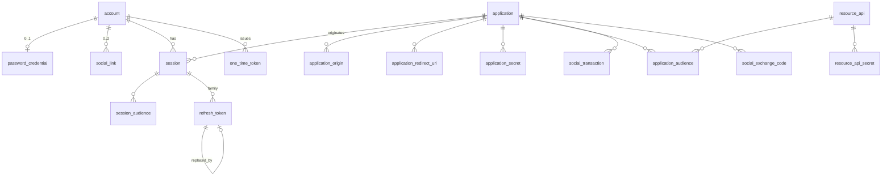

# Achernar Identity — Modelo de Dados Físico (PostgreSQL 18)

Documento **técnico** (D-49): tipos, restrições e índices. O modelo lógico por feature está em `specs/FT-xx/database.md`. Regras de projeto:
snake_case singular; `timestamptz` em UTC; chaves `uuid`; `version bigint` para controle otimista onde indicado; `CHECK` para domínios;
`ddl-auto=validate`; mudanças somente via Liquibase (D-36). Segredos nunca em claro: senhas = Argon2id; tokens/segredos = SHA-256 (alta entropia);
chaves privadas e payloads sensíveis = AES-256-GCM com `ACHERNAR_MASTER_KEY`.

## 1. Diagrama (relacionamentos)

`security_event`, `email_outbox`, `rate_limit_counter`, `login_lock`, `signing_key` são independentes (sem FK para entidades de negócio).

## 2. Tabelas

### 2.1 `account` (RN-ACC-*)
| Coluna | Tipo | Null | Restrição |
|---|---|---|---|
| id | uuid | N | PK (UUIDv4; = `sub`) |
| email_display | varchar(254) | N | como digitado (trim) |
| email_normalized | varchar(254) | N | **UNIQUE** (D-14) |
| status | varchar(24) | N | CHECK IN (`PENDING_VERIFICATION`,`ACTIVE`,`DISABLED`) |
| role | varchar(16) | N | default `USER`; CHECK IN (`USER`,`ADMIN`) |
| email_verified_at | timestamptz | S | CHECK (`status`<>'ACTIVE' OR `email_verified_at` IS NOT NULL) |
| locale | varchar(8) | N | default `pt-BR`; CHECK IN (`pt-BR`,`en`) |
| disabled_at / disabled_reason | timestamptz / varchar(200) | S | `disabled_at` NOT NULL quando `status`=`DISABLED` |
| anonymized_at | timestamptz | S | CHECK (`anonymized_at` IS NULL OR `status`='DISABLED') |
| created_at / updated_at | timestamptz | N | — |
| version | bigint | N | otimista |

Índices: `uq_account_email_normalized`; `ix_account_pending_created (created_at) WHERE status='PENDING_VERIFICATION'` (purga);
`ix_account_active_admin (id) WHERE role='ADMIN' AND status='ACTIVE'` (último admin); `ix_account_email_prefix (email_normalized text_pattern_ops)`;
`ix_account_status_created (status, created_at DESC)` (listagem/filtros); `ix_account_role (role)`.

### 2.2 `password_credential`
`account_id uuid PK FK→account ON DELETE CASCADE`, `password_hash varchar(255) NOT NULL`, `changed_at timestamptz NOT NULL`, `created_at timestamptz NOT NULL`.

### 2.3 `social_link`
| Coluna | Tipo | Restrição |
|---|---|---|
| id | uuid | PK |
| account_id | uuid | FK→account ON DELETE CASCADE |
| provider | varchar(16) | CHECK IN (`GOOGLE`,`FACEBOOK`) |
| provider_subject | varchar(255) | NOT NULL |
| provider_email | varchar(254) | S (informativo; não usado para decidir) |
| linked_at / last_login_at | timestamptz | — |

Únicos: `uq_social_identity (provider, provider_subject)`; `uq_social_account_provider (account_id, provider)`.

### 2.4 `application` (+ filhos)
`application`: `id uuid PK`; `client_id varchar(64) UNIQUE CHECK (client_id ~ '^[a-z0-9-]{3,64}$')`; `name varchar(100) NOT NULL`;
`description varchar(500)`; `type varchar(16) CHECK IN ('BROWSER','CONFIDENTIAL')`; `status varchar(16) CHECK IN ('ACTIVE','DISABLED')`;
`allow_registration boolean`; `identity_api_access boolean`; `google_enabled boolean`; `facebook_enabled boolean`;
`access_token_ttl_seconds int NULL CHECK (BETWEEN 300 AND 900)`; `verify_email_url`, `reset_password_url`, `confirm_email_change_url varchar(500)`;
`is_system boolean` (aplicação semeada da UI: não muda `type` nem pode ser desativada se for a única com `identity_api_access`); `created_at, updated_at, version`.

| Filha | Colunas | PK / únicos |
|---|---|---|
| `application_origin` | application_id FK CASCADE, origin varchar(255) | PK (application_id, origin) |
| `application_redirect_uri` | application_id FK CASCADE, uri varchar(500) | PK (application_id, uri) |
| `application_audience` | application_id FK, resource_api_id FK, is_default boolean | PK (application_id, resource_api_id) |
| `application_secret` | id uuid PK, application_id FK, secret_hash char(64), created_at, revoked_at, last_used_at | `uq_app_secret_hash (secret_hash)`; ≤ 2 ativos por aplicação (serviço com trava na linha de `application`) |

Índices: `ix_app_status (status)`; `ix_app_secret_app_active (application_id) WHERE revoked_at IS NULL`.

### 2.5 `resource_api` (+ credencial)
`resource_api`: `id uuid PK`; `audience varchar(200) UNIQUE NOT NULL`; `name varchar(100)`; `description varchar(500)`; `status` CHECK ('ACTIVE','DISABLED'); `created_at, updated_at, version`.
`resource_api_secret`: `id uuid PK`, `resource_api_id FK`, `secret_hash char(64) UNIQUE`, `created_at`, `revoked_at`, `last_used_at`.

### 2.6 `session` (+ `session_audience`)
| Coluna | Tipo | Restrição |
|---|---|---|
| id | uuid | PK (= `sid`) |
| account_id | uuid | FK→account ON DELETE CASCADE |
| application_id | uuid | FK→application |
| amr | varchar(16) | CHECK IN (`pwd`,`google`,`facebook`) |
| created_at / auth_time | timestamptz | N |
| last_used_at | timestamptz | N |
| expires_at | timestamptz | N (= created_at + P-03) |
| last_reauth_at | timestamptz | N |
| revoked_at / revoke_reason | timestamptz / varchar(24) | CHECK reason IN (`LOGOUT`,`USER`,`USER_ALL`,`ADMIN_DISABLED`,`PASSWORD_RESET`,`PASSWORD_CHANGED`,`EMAIL_CHANGED`,`REUSE_DETECTED`,`SESSION_LIMIT`,`APP_DISABLED`,`ANONYMIZED`,`KEY_COMPROMISE`) |
| ip | inet | S (truncável) |
| user_agent | varchar(255) | S |

`session_audience(session_id FK CASCADE, audience varchar(200), PK(session_id, audience))`.
Índices: `ix_session_account_active (account_id, last_used_at DESC) WHERE revoked_at IS NULL`; `ix_session_app_active (application_id) WHERE revoked_at IS NULL`;
`ix_session_purge (COALESCE(revoked_at, expires_at))`.

### 2.7 `refresh_token`
`id uuid PK`; `session_id uuid FK CASCADE`; `token_hash char(64) UNIQUE`; `created_at`; `expires_at`; `rotated_at timestamptz NULL`; `replaced_by_id uuid NULL FK→refresh_token`.
**Único** `uq_refresh_one_active (session_id) WHERE rotated_at IS NULL` (um token corrente por sessão). Índices: `ix_refresh_session (session_id, created_at DESC)`; `ix_refresh_expires (expires_at)`.
Reuso: token com `rotated_at` preenchido e `replaced_by_id` ≠ NULL é antecessor; a tolerância (P-04) vale quando `rotated_at > now() − P-04` **e** `replaced_by_id` é o token corrente (antecessor imediato).

### 2.8 `one_time_token`
`id uuid PK`; `account_id FK CASCADE`; `purpose varchar(24) CHECK IN ('EMAIL_VERIFICATION','PASSWORD_RESET','EMAIL_CHANGE')`; `token_hash char(64) UNIQUE`;
`application_id uuid NULL FK` (origem do link); `new_email_display varchar(254) NULL`; `new_email_normalized varchar(254) NULL` (obrigatórios iff `EMAIL_CHANGE`, CHECK);
`created_at`; `expires_at`; `consumed_at NULL`; `invalidated_at NULL`.
Único parcial: `uq_ott_active (account_id, purpose) WHERE consumed_at IS NULL AND invalidated_at IS NULL`. Índice: `ix_ott_purge (LEAST(expires_at, consumed_at, invalidated_at))` ou `(expires_at)`.

### 2.9 `social_transaction`
`id uuid PK`; `state_hash char(64) UNIQUE`; `provider`; `purpose CHECK IN ('LOGIN','LINK','REAUTH')`; `application_id FK`; `redirect_uri varchar(500)`; `client_state varchar(500) NULL`;
`client_code_challenge varchar(128) NULL` (obrigatório para `LOGIN`); `audiences varchar(2000) NULL`; `nonce varchar(64) NULL`; `provider_code_verifier_enc bytea NOT NULL`;
`browser_binding_hash char(64) NOT NULL`; `account_id uuid NULL`, `session_id uuid NULL` (LINK/REAUTH); `created_at`; `expires_at`; `consumed_at NULL`.
Índice de purga em `expires_at`.

### 2.10 `social_exchange_code`
`id uuid PK`; `code_hash char(64) UNIQUE`; `account_id FK`; `application_id FK`; `provider`; `audiences varchar(2000) NULL`; `redirect_uri varchar(500)`; `code_challenge varchar(128)`; `created_at`; `expires_at`; `consumed_at NULL`; `session_id uuid NULL` (preenchido ao consumir; um segundo uso do mesmo código revoga essa sessão — RFC 6749 §4.1.2).

### 2.11 `signing_key`
`id uuid PK`; `kid varchar(64) UNIQUE`; `algorithm varchar(8) CHECK ('RS256')`; `public_jwk jsonb NOT NULL`; `private_key_enc bytea NOT NULL` (NULL após `REMOVED`);
`status CHECK IN ('PUBLISHED','ACTIVE','RETIRED','REMOVED')`; `created_at`; `publish_at`; `activate_at`; `retire_at NULL`; `remove_at NULL`; `removal_reason varchar(24) NULL`.
Único parcial: `uq_signing_key_one_active ((true)) WHERE status='ACTIVE'`.

### 2.12 `security_event` (D-26)
`id uuid PK` (UUIDv7); `occurred_at timestamptz NOT NULL`; `event_type varchar(48)`; `severity CHECK ('INFO','NOTICE','ALERT')`; `outcome CHECK ('SUCCESS','FAILURE')`;
`account_id uuid NULL` e `actor_account_id uuid NULL` (**sem FK**: eventos sobrevivem a purgas); `client_id varchar(64) NULL`; `session_id uuid NULL`; `ip inet NULL`;
`user_agent varchar(255) NULL`; `request_id varchar(64)`; `details jsonb NOT NULL DEFAULT '{}'`.
Índices: `ix_event_time (occurred_at DESC)`; `ix_event_account (account_id, occurred_at DESC)`; `ix_event_type (event_type, occurred_at DESC)`; `ix_event_client (client_id, occurred_at DESC)`;
`ix_event_alert (occurred_at DESC) WHERE severity='ALERT'`. Privilégios: papel de aplicação sem `UPDATE` exceto colunas `ip`, `user_agent`; `DELETE` só pelo job (mesmo papel; auditado por `RETENTION_PURGE_RUN`).

### 2.13 `email_outbox`
`id uuid PK` (v7); `template varchar(32)`; `locale varchar(8)`; `to_address varchar(254)`; `account_id uuid NULL`; `application_id uuid NULL`; `payload_enc bytea NULL` (apagado ao enviar);
`status CHECK IN ('PENDING','SENT','FAILED')`; `attempts int NOT NULL DEFAULT 0`; `next_attempt_at timestamptz`; `locked_until timestamptz NULL`; `last_error varchar(300) NULL` (sem dados pessoais);
`created_at`; `sent_at NULL`. Índice: `ix_outbox_due (next_attempt_at) WHERE status='PENDING'`; `ix_outbox_purge (status, created_at)`.

### 2.14 `rate_limit_counter` e `login_lock`
`rate_limit_counter(key varchar(200), window_start timestamptz, count int, PRIMARY KEY (key, window_start))`; upsert atômico `INSERT … ON CONFLICT DO UPDATE SET count = count + 1 RETURNING count`.
`login_lock(key_hash char(64) PK /* sha256(email_normalized) */, failure_count int, window_start timestamptz, locked_until timestamptz NULL, lock_level int, last_lock_at timestamptz NULL)`.
Sem e-mail em claro nestas tabelas (RNF-15).

### 2.15 Liquibase
`databasechangelog` e `databasechangeloglock` (padrão da ferramenta).

## 3. Integridade e consistência

| ID | Regra | Mecanismo |
|---|---|---|
| DM-01 | E-mail único | `uq_account_email_normalized` |
| DM-02 | Conta `ACTIVE` sempre com e-mail verificado | CHECK |
| DM-03 | 1 vínculo por provedor por conta; 1 conta por identidade social | únicos de `social_link` |
| DM-04 | 1 refresh corrente por sessão | `uq_refresh_one_active` |
| DM-05 | 1 token de uso único ativo por (conta, finalidade) | `uq_ott_active` |
| DM-06 | 1 chave `ACTIVE` | `uq_signing_key_one_active` |
| DM-07 | Último admin ativo | trava consultiva `pg_advisory_xact_lock` + contagem na mesma transação (D-43) |
| DM-08 | ≥ 1 método de acesso | verificação transacional ao desvincular (com `SELECT … FOR UPDATE` da conta) |
| DM-09 | Segredos ≤ 2 ativos | trava na linha de `application`/`resource_api` + contagem |
| DM-10 | Limite de sessões | trava consultiva por conta + revogação da menos recente |
| DM-11 | Consumo único de tokens/códigos/transações | `UPDATE … WHERE consumed_at IS NULL AND expires_at > now()` (1 linha afetada = sucesso) |
| DM-12 | Cadastro concorrente do mesmo e-mail | violação de `uq_account_email_normalized` tratada como “duplicado” (RN-ACC-06) |

## 4. Retenção e purga (job diário — UC-091/092)

| Alvo | Regra | Param. |
|---|---|---|
| `account` `PENDING_VERIFICATION` | `created_at < now()−P-50` (cascata: credencial, tokens, vínculos) | P-50 |
| `one_time_token`, `social_transaction`, `social_exchange_code` | `expires_at/consumed_at < now()−P-51` | P-51 |
| `session` + `refresh_token` + `session_audience` | `COALESCE(revoked_at,expires_at) < now()−P-52` | P-52 |
| `security_event` | `occurred_at < now()−P-53`; `ip,user_agent := NULL` para `occurred_at < now()−P-54` | P-53, P-54 |
| `email_outbox` | `SENT` > P-55; `FAILED` > P-41 | P-55, P-41 |
| `rate_limit_counter`, `login_lock` ociosos | > P-56 | P-56 |
| `signing_key` `REMOVED` | remove linha após P-59 | P-59 |

Purgas em lotes (ex.: 1000 linhas), idempotentes, tolerantes a concorrência (`FOR UPDATE SKIP LOCKED`).

## 5. Volumetria estimada (projeto freelancer típico)
10⁴–10⁶ contas; ~10 sessões/conta ativa; eventos ~50/conta/ano. Nenhum particionamento necessário até ~10⁸ eventos; se necessário, particionar `security_event` por mês (decisão futura).
