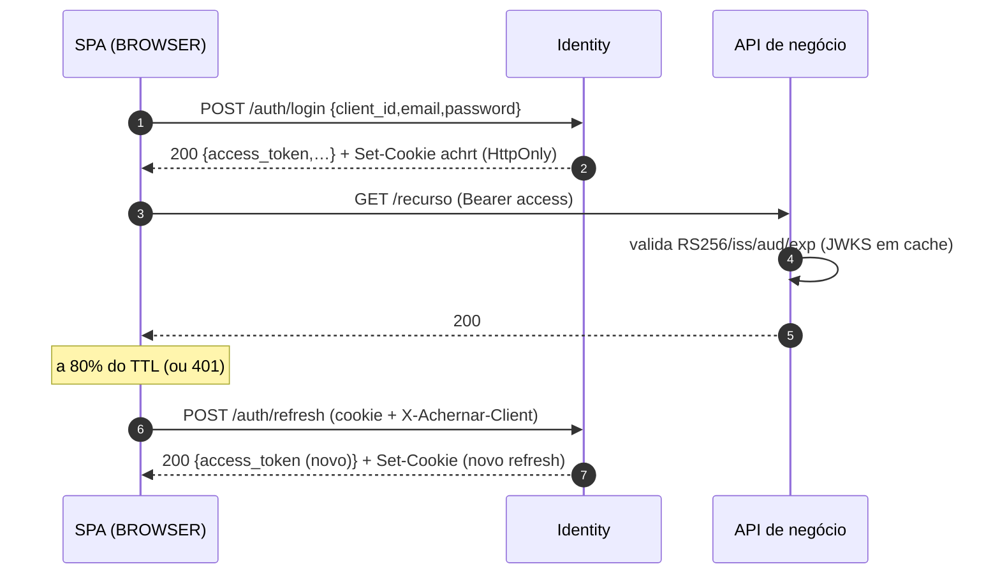
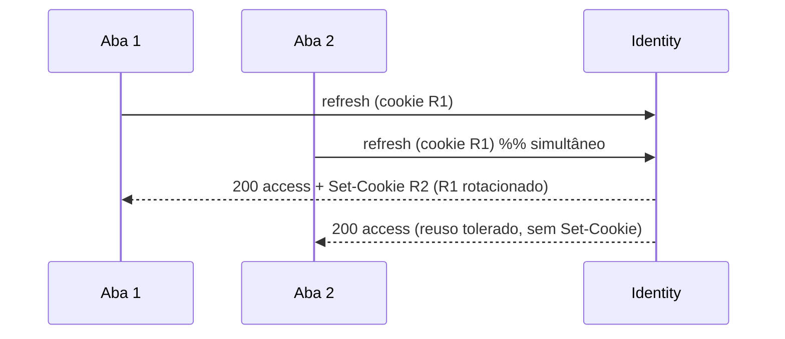

# Achernar Identity — Ciclo de Vida de Tokens, Sessões e Chaves

Normativo para FT-03, FT-06, FT-07, FT-10 e para o guia de integração. Decisões: D-04…D-10, D-25, D-43. Regras: RN-TOK-01…15, RN-SES-*.

## 1. Access token (JWT)

Cabeçalho: `{"alg":"RS256","typ":"at+jwt","kid":"<thumbprint>"}`. Exemplo de payload (valores ilustrativos):

```json
{
  "iss": "https://id.exemplo.com.br",
  "sub": "3f0e6b1c-5d0a-4f1e-9a7c-0d6a3c1b2e44",
  "aud": ["https://api.exemplo.com.br", "https://reports.exemplo.com.br", "achernar-identity-api"],
  "exp": 1792243800, "iat": 1792243200, "nbf": 1792243200,
  "jti": "a1c4…", "sid": "6b0d…", "azp": "meu-app-web",
  "amr": ["pwd"], "auth_time": 1792242900,
  "roles": ["ADMIN"]
}
```

| Claim | Obrigatório | Descrição / regra |
|---|---|---|
| `iss` | sim | `ACHERNAR_ISSUER` (P-60), igual byte a byte à configuração das APIs |
| `sub` | sim | `account.id` (RN-ACC-03). **Único vínculo** com sistemas de negócio |
| `aud` | sim | **array** de audiências (RN-APP-17); sempre array, mesmo com 1 elemento |
| `exp`/`iat`/`nbf` | sim | segundos Unix; `exp − iat` = TTL (P-01 / override da aplicação) |
| `jti` | sim | id único do token (não há lista de `jti`; serve a logs/diagnóstico) |
| `sid` | sim | id da sessão (`session.id`); chave da introspecção/revogação |
| `azp` | sim | `client_id` da aplicação que obteve o token |
| `amr` | sim | `["pwd"]`, `["google"]` ou `["facebook"]` |
| `auth_time` | sim | instante da autenticação que criou a sessão |
| `roles` | condicional | `["ADMIN"]` somente se `aud` inclui P-63 e a conta é ADMIN; **informativo** — o Identity reconfere no banco (RN-ADM-01) |

Não há `email`, nome, telefone, permissões de negócio nem escopos. Algoritmos aceitos/emitidos: apenas `RS256` (D-04).
Tamanho típico: < 1 KB.

## 2. Refresh token

- Valor: 32 bytes aleatórios (CSPRNG) em base64url (43 caracteres), prefixo opcional `ach_rt_` ignorado no hash? **Não** usar prefixo (evita falsas expectativas de formato).
- Guardado: `SHA-256(valor)` em `refresh_token.token_hash`.
- Entrega: `BROWSER` ⇒ cookie `__Secure-achrt_<client_id>` (HttpOnly, Secure, SameSite=Strict, Path=/auth, Max-Age = validade restante, sem `Domain`). `CONFIDENTIAL` ⇒ corpo da resposta.
- Em `dev` (HTTP): `ACHERNAR_COOKIE_SECURE=false` ⇒ nome `achrt_<client_id>` (sem prefixo `__Secure-`, que exige Secure).

### 2.1 Algoritmo de renovação (`POST /auth/refresh`) — normativo

1. Validar cliente (D-07/D-08): `BROWSER` ⇒ `Origin` ∈ origens da aplicação e `X-Achernar-Client` = `client_id`; `CONFIDENTIAL` ⇒ Basic válido. Aplicar P-36.
2. Obter o refresh (cookie ou corpo); ausente ⇒ `INVALID_REFRESH_TOKEN`.
3. Em **uma transação**, localizar por `token_hash` com `SELECT … FOR UPDATE` (serializa abas/requisições concorrentes). Não encontrado ⇒ `INVALID_REFRESH_TOKEN`.
4. Se a sessão pertence a outra aplicação ⇒ `INVALID_REFRESH_TOKEN` (RN-TOK-08).
5. Se sessão revogada/expirada, token expirado, conta ≠ `ACTIVE` ou aplicação inativa ⇒ `INVALID_REFRESH_TOKEN` (RN-TOK-06).
6. **Token corrente** (`rotated_at IS NULL`): gerar novo refresh; marcar o atual `rotated_at = now`, `replaced_by_id = novo`; `expires_at(novo) = min(now + P-02, session.expires_at)`; atualizar `session.last_used_at`; emitir access (audiências ⊆ sessão; omite APIs desativadas); responder com `refresh_rotated=true`.
7. **Token já rotado**:
   a. se `replaced_by_id` é o token corrente da sessão **e** `now − rotated_at ≤ P-04` ⇒ **reuso tolerado**: emitir apenas novo access; **não** emitir refresh nem alterar cookie; `refresh_rotated=false`; evento `REFRESH_REUSE_TOLERATED`.
   b. caso contrário ⇒ **reuso detectado**: revogar a sessão (`REUSE_DETECTED`), evento `REFRESH_REUSE_DETECTED` (ALERT, em transação independente), responder `INVALID_REFRESH_TOKEN`; no `BROWSER`, limpar o cookie.
8. Resposta: tokens (§1.2 de `api-conventions.md`), `Cache-Control: no-store`.

### 2.2 Validade (exemplos com P-01=10 min, P-02=7 d, P-03=30 d)

| Momento | `expires_at` do refresh corrente | Observação |
|---|---|---|
| Login em D0 | D0 + 7 d | sessão expira (absoluto) em D0 + 30 d |
| Refresh em D5 | D5 + 7 d = D12 | deslizante |
| Refresh em D25 | min(D32, D30) = **D30** | teto absoluto |
| Sem uso por 7 d | expira | `INVALID_REFRESH_TOKEN`; nova autenticação |

## 3. Sessões

- Criada em: login por senha (UC-020) e troca de código social (UC-052). Contém: conta, aplicação, `amr`, `auth_time`, audiências concedidas, `last_reauth_at = auth_time`, IP e agente.
- Limite P-05 por conta (D-44): ao criar a 11ª, revoga a de `last_used_at` mais antigo (`SESSION_LIMIT`), sob trava consultiva da conta.
- `sid` no token é a chave para: listagem (UC-040), revogação (UC-041/042), introspecção (UC-073), validação imediata na API do Identity (RN-TOK-15).

## 4. Revogação — matriz por evento

| Evento | Sessões revogadas | Tokens de uso único | Access tokens já emitidos | Obrigação das APIs |
|---|---|---|---|---|
| Logout (UC-022) | a sessão do refresh | — | válidos até `exp` | operações sensíveis ⇒ introspecção |
| Revogar sessão (UC-041) | a sessão indicada | — | idem | idem |
| Encerrar todas (UC-042) | todas (opcionalmente exceto a atual) | — | idem | idem |
| Troca de senha (UC-032) | demais sessões | invalida recuperação pendente | idem | idem |
| Redefinição de senha (UC-031) | **todas** | invalida verificação? não; invalida outras recuperações/trocas de e-mail | idem | idem |
| Troca de e-mail (UC-036) | demais sessões | invalida recuperação pendente | idem | idem |
| Desativação da conta (UC-081) | **todas** | **todos** | idem; introspecção ⇒ `active=false` | **bloqueio imediato exige introspecção** |
| Anonimização (UC-084) | todas | todos | idem | idem |
| Reuso de refresh (UC-021) | a sessão | — | idem | idem |
| Desativação de aplicação (UC-062) | todas da aplicação | — | idem | idem |
| Chave comprometida removida (UC-072) | nenhuma (opção: todas) | — | **inválidos assim que a API atualizar o JWKS** (≤ P-14) | respeitar `Cache-Control`; refetch em `kid` desconhecido |

**Política para o período restante de validade (RN-TOK-09):** o access token é autocontido e permanece aceitável até `exp` (≤ 10 min, máx. 15 min). Aceita-se esse risco para
operações comuns. Para **bloqueio imediato** (desativação, comprometimento, ações financeiras/irreversíveis, administrativas), a API **deve** consultar a introspecção
(RN-TOK-11) com cache ≤ P-46 (30 s) e **deve** negar quando `active=false`. APIs podem adotar a introspecção em todas as chamadas se o custo for aceitável (p95 ≤ 80 ms, RNF-02).
Falha de comunicação com o Identity na introspecção: a API deve **falhar fechado** para operações sensíveis e pode degradar para validação local nas demais.

## 5. Concorrência e múltiplas abas

| Cenário | Comportamento |
|---|---|
| 2 abas renovam ao mesmo tempo (mesmo cookie) | A 1ª rotaciona; a 2ª (aguardou o lock) cai no reuso tolerado (§2.1-7a) e recebe só novo access; o cookie já é o do vencedor |
| Aba lenta reenvia refresh antigo após > P-04 | reuso detectado ⇒ sessão revogada ⇒ novo login (sinal de comprometimento) |
| Cliente web (obrigatório) | `navigator.locks.request('achernar-refresh:<client_id>')` serializa; ao obter o lock, verifica se o access em memória/`BroadcastChannel` já foi renovado há < 5 s e pula a chamada; propaga novo access/`expires_at`/logout via `BroadcastChannel('achernar:<client_id>')` |
| Sem Web Locks | atraso aleatório 0–300 ms + dependência da tolerância do servidor |
| Cliente `CONFIDENTIAL` multi-thread | mutex por `session_id`; ao receber `refresh_rotated=false`, manter o refresh atual |
| Logout em uma aba | `BroadcastChannel` notifica; demais abas descartam o access e vão ao login |
| Renovação na expiração do access | cliente renova **proativamente** a 80 % do TTL ou ao receber 401 uma única vez |

## 6. Chaves de assinatura

```text
Dia 0           Dia 89            Dia 90                  Dia 92 (90 + P-12)
K1 ACTIVE ──────▶ K2 PUBLISHED ──▶ K2 ACTIVE, K1 RETIRED ──▶ K1 REMOVED
                  (no JWKS, não assina) (K2 assina; K1 só no JWKS)  (sai do JWKS)
```

- Rotação automática (UC-071, job a cada hora): se `now ≥ ACTIVE.activate_at + P-10 − P-11` e não há `PUBLISHED` ⇒ gera K_next `PUBLISHED`; se existe `PUBLISHED` com `now ≥ publish_at + P-11` ⇒ promove a `ACTIVE`, move a antiga a `RETIRED`; `RETIRED` com `now ≥ retire_at + P-12` ⇒ `REMOVED` (apaga a chave privada).
- Invariantes: 1 chave `ACTIVE`; JWKS = `PUBLISHED ∪ ACTIVE ∪ RETIRED`; `kid` = thumbprint (RFC 7638).
- Condições de configuração: P-11 ≥ 2 × P-14; P-12 ≥ P-01 + P-06 + P-14 (senão falha de subida).
- Primeira subida sem chaves: gera K0 e a ativa imediatamente.
- **Rotação manual**: gera K_next, a ativa imediatamente (sem espera P-11) e aposenta a atual (uso planejado: troca de política).
- **Remoção emergencial** (`POST …/signing-keys/{kid}/remove` com `emergency=true`): marca `REMOVED` na hora, gera e ativa substituta; tokens assinados pela chave removida passam a ser rejeitados quando cada API renovar o JWKS (≤ P-14); opção `revoke_all_sessions=true`.
- Multi-instância: todas leem o conjunto do banco; a ativação usa transação com trava; cache local do JWKS de assinatura ≤ 60 s.

## 7. Introspecção (`POST /api/v1/tokens/introspect`)

Entrada (form ou JSON): `token`. Autenticação: Basic `audience:segredo` (RN-APP-16). Saída ativa:
`{"active":true,"sub":"…","sid":"…","aud":[…],"azp":"…","exp":…,"iat":…,"amr":["pwd"],"client_id":"…"}`; inativa: `{"active":false}`. Sempre `200`
(exceto `401 INVALID_CLIENT`/`429`). Ativo ⇔ RN-TOK-11. Não aceita refresh tokens.

## 8. Diagramas





## 9. Bloqueios e erros resultantes (resumo)

| Situação | Resposta |
|---|---|
| Refresh ausente/desconhecido/expirado/revogado/de outro cliente/reuso | `401 INVALID_REFRESH_TOKEN` (cookie limpo no BROWSER) |
| Access expirado em API do Identity | `401` `invalid_token` |
| Access de sessão revogada em API do Identity | `401 SESSION_REVOKED` |
| `aud` sem P-63 em API do Identity | `401` `invalid_token` |
